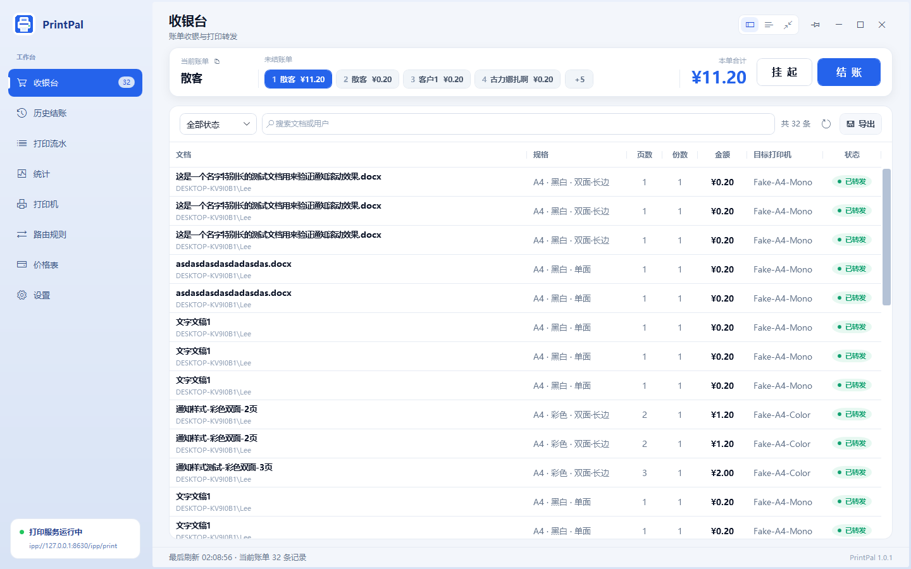
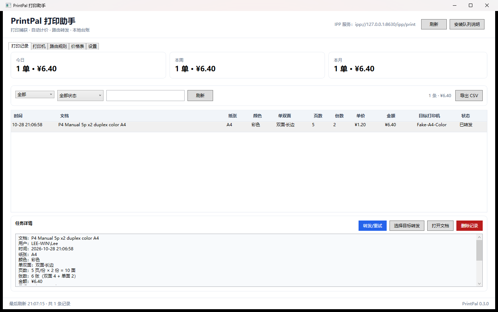
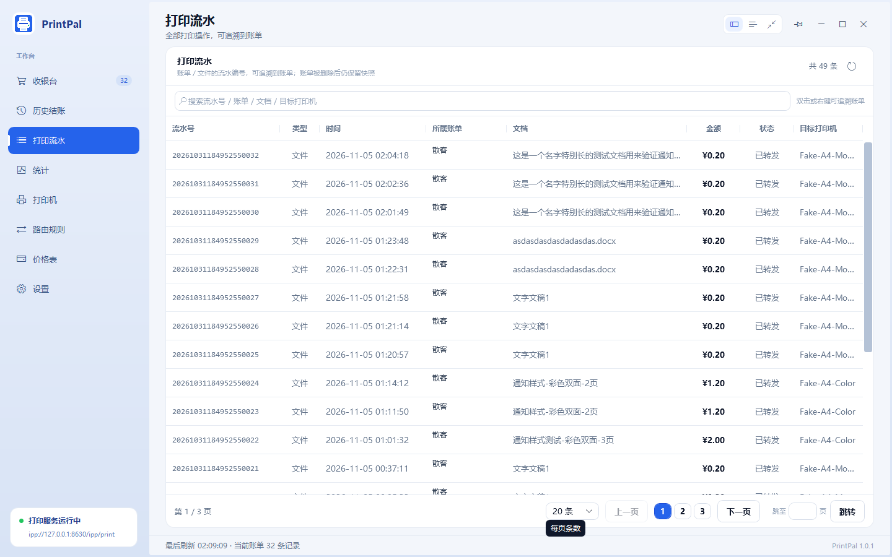
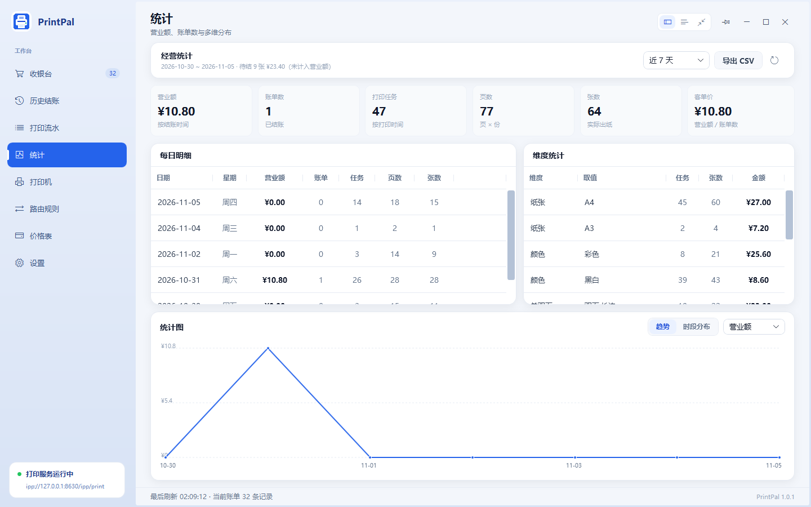
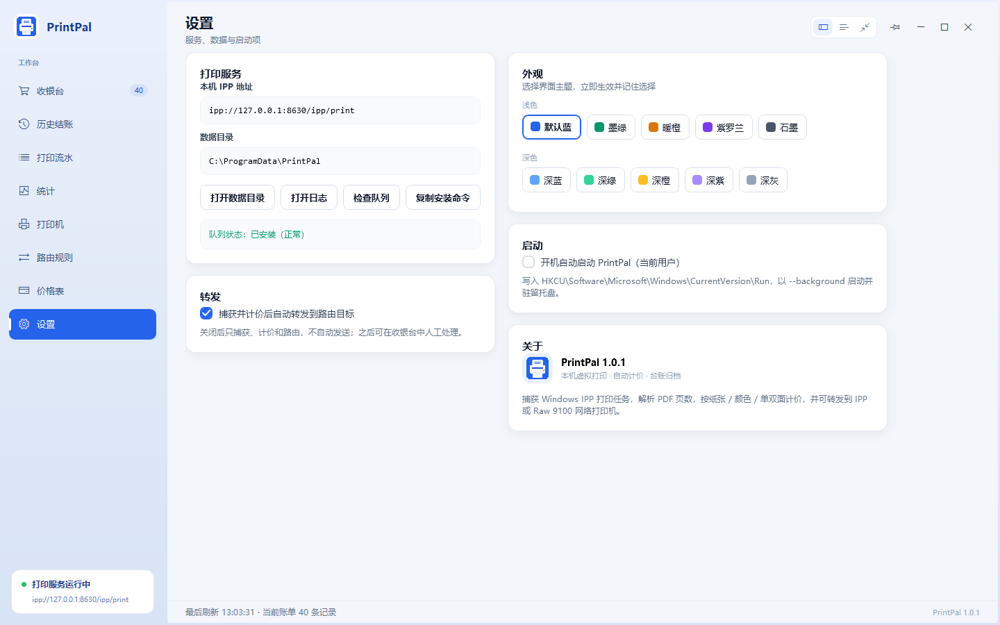
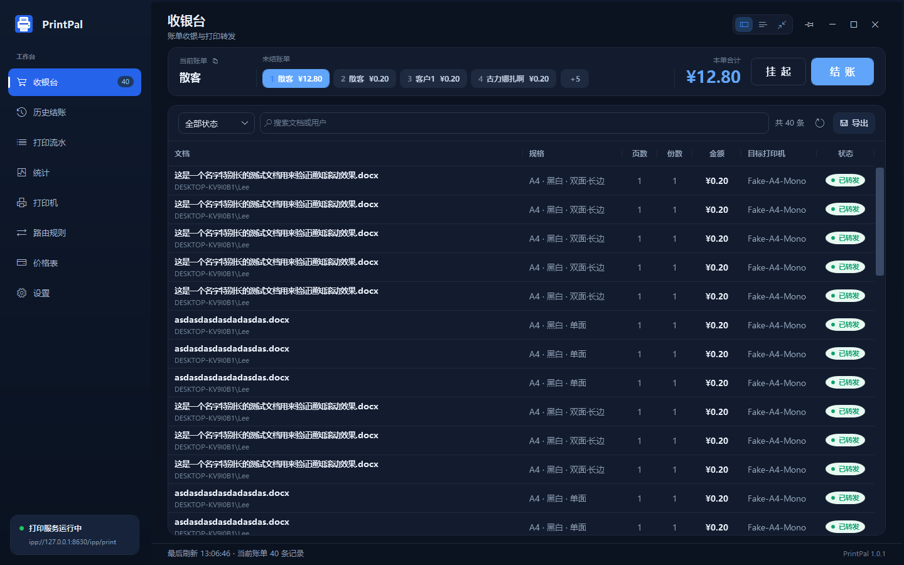

# PrintPal

PrintPal 是一个 Windows 10 / Windows 11 的打印计费工具：用户在 WPS / Office / 记事本中打印到
**“PrintPal 虚拟打印机”**，PrintPal 捕获打印参数，按纸张/颜色/单双面/页数/份数计价，并按路由规则
转发到真实打印机。开发环境没有真实打印机，因此附带一个可多实例部署的 **FakePrinter** 来模拟
真实打印机的 IPP / Raw 9100 接口。

## 当前状态

| 阶段 | 状态 |
|---|---|
| P0 环境 + IPP 捕获可行性 | **Win11 与 Win10 均通过** |
| P1 骨架 + 领域/计价/路由 + IPP 库 + FakePrinter | **完成，87 个测试通过** |
| P2 IPP 捕获服务 + 作业流水线 + 队列安装 | **完成，真实队列 E2E 通过** |
| P3 WPF UI / 托盘 / 设置 | **完成，UI 冒烟通过；2026-10-29 界面重构** |
| P4 异步转发 / 重试 / 人工确认 | **完成，Held→人工转发 E2E 通过** |
| P5 自包含发布 + 安装/卸载/修复/诊断 | **完成，安装 E2E 通过** |
| P6 Win10/Win11 E2E + 验收 | **Win11 + Win10 均 PASS；MVP 0.5.0 验收通过** |
| P7 Windows 服务 + MSI | **完成：1.0.1；服务 Running；MSI 向导/升级/修复/回滚；未签名** |

### P0 实测结论

- Windows 11 26300 与 Windows 10 22H2 19045 都能创建本机 IPP 队列。
- 两个系统实际发送的都是 **gzip/未压缩 PDF**；页数由 PdfPig 从 PDF 解析。
- `copies` / `sides` / `print-color-mode` / `media-col` 均能拿到。
- **WPS 在 IPP 队列下正确传递 `copies`**，没有出现旧 PSA 调研中的“内容倍乘”现象。
- Win10 需要先显式安装 IPP Class Driver：
  `Add-PrinterDriver -Name 'Microsoft IPP Class Driver'`
  （驱动 INF 在 DriverStore 中，但被 `ExcludeFromSelect` 隐藏）。
- Windows 的 IPP 属性类型很敏感：`media-*-margin-supported` 必须是 integer、
  `finishings-*` 必须是 enum、`document-format-details-supported` 必须是 keyword、
  `printer-uri-supported` 必须包含 `ipp://`、A3 关键字必须用 `iso_a3_297x420mm`。

详见 [P0 捕获报告](docs/spikes/ipp-capture.md) 与 [环境记录](docs/spikes/environment.md)。

## 计价模型

- 价格按 **“张”** 配置：`SimplexPriceCents`（单面价/张）、`DuplexPriceCents`（双面价/张）。
- 双面任务按 **每份** 计算，奇数页最后一张按单面价，再乘份数：
  ```
  每份双面张数 = P / 2
  每份单面张数 = P % 2
  每份金额     = (P / 2) × 双面价 + (P % 2) × 单面价
  总金额       = 每份金额 × N
  ```
- 不能把 `P × N` 先合并再算：不同份的单面纸不能拼成一张双面纸。
- 默认价目（可改）：A4 黑白 0.20/0.30，A4 彩色 0.80/1.20；A3 0.40/0.60、1.60/2.40；
  A5 0.15/0.22、0.60/0.90；Letter/Legal/未知纸张按 A4 价。

## 解决方案结构

```
src/
  PrintPal.Core/          领域模型、纸张/颜色/双面、计价、路由
  PrintPal.Ipp/           IPP 编解码、客户端、服务端、Windows 兼容能力集
  PrintPal.Capture/       文档嗅探、页数解析（PDF/PS/OXPS）、文档存储
  PrintPal.Storage/       SQLite 持久化（任务/打印机/价格/路由/设置）
  PrintPal.Forwarding/    IPP 转发、Raw 9100 转发
  PrintPal.Agent/         捕获→计价→路由→异步转发/重试、Agent 生命周期
  PrintPal.AgentHost/     P2 控制台宿主（自动化/无界面验证）
  PrintPal.App/           P3–P5 WPF UI：收银台/打印机/路由/价格/设置/托盘
  PrintPal.FakePrinter/   模拟真实打印机（IPP + Raw，多实例，控制台输出）
scripts/
  install/                P5 安装/卸载/修复/诊断（PowerShell）
  publish/                P5 自包含 win-x64 打包
tools/
  PrintPal.IppProbe/      P0 IPP 诊断探针
  PrintPal.PrintProbe/    P0 可控打印测试工具
tests/                    Core/Ipp/Capture/Storage/Integration 测试
docs/                     架构/UI/运行/安装/测试/ADR
docs/spikes/              P0 证据与结论
dist/PrintPal-0.5.0-win-x64/  P5 自包含安装包（生成）
dist/p0-win10/            Win10 自包含 P0 验证包
artifacts/                P0–P5 捕获/安装证据（不入库）
参考资料/                 只读参考资料（不入库）
```

## 构建与测试

```powershell
dotnet build PrintPal.sln -c Debug
dotnet test PrintPal.sln -c Debug
```

当前：**121 个测试全部通过**（Core 57 / IPP 12 / Capture 10 / Storage 28 / Integration 14）。

### 开发约定：测试后保留现场（不要关闭 APP）

- 开发/验证完成后**不要关闭 PrintPal.App**，也不要停 `PrintPal.Service` 或 FakePrinter——
  用户要接着手工验证（"转发/重试"依赖 FakePrinter 在线）；
- 只有用户明确要求、或构建/安装升级必须重启时才停，重启后立即带测试数据启动并保持运行；
- AI 代理的完整约定（命令、端口、数据目录、例外情况）见 [AGENTS.md](AGENTS.md)，
  人工流程见 [运行手册](docs/runbook.md)。

## P2 端到端（真实队列 + FakePrinter）

```powershell
# 1. 启动 3 台模拟打印机
.\scripts\Start-FakePrinters.ps1

# 2. 启动 Agent（默认 8630，自动 seed 3 台打印机 + 路由 + 价格）
.\scripts\Start-PrintPalAgent.ps1

# 3. 管理员 PowerShell 安装队列
powershell.exe -NoProfile -ExecutionPolicy Bypass -File .\scripts\Install-PrintPalQueue.ps1

# 4. 打印 5 页 x 2 份，A4 彩色双面
.\tools\PrintPal.PrintProbe\bin\Debug
et10.0-windows\PrintPal.PrintProbe.exe `
  --printer "PrintPal Virtual Printer" --pages 5 --copies 2 --duplex long --color color --paper A4 `
  --name "P2 E2E 5p x2 duplex color A4"
```

实测：Agent 记录 **¥6.40** → Fake-A4-Color 收到 PDF（5 页，534,354 B）→ `Succeeded`。
清理：

```powershell
powershell.exe -NoProfile -ExecutionPolicy Bypass -File .\scripts\Uninstall-PrintPalQueue.ps1
.\scripts\Stop-PrintPalAgent.ps1
.\scripts\Stop-FakePrinters.ps1
```

## P3 WPF UI

```powershell
.\scripts\Start-PrintPalApp.ps1 -SeedDemo
```



- 布局：随主题变化的浅色外壳（浅色渐变侧边栏）+ 内缩 6 px 的浅色圆角主面板；左侧导航上下延伸包裹面板；
  当前账单/挂起区/金额条 + 右侧打印详情；完整/紧凑/极简三模式统一视觉；
- 收银台：状态/搜索筛选，文档/规格/份数/金额/目标/状态列，打印详情（顶部分组：状态 + 本任务金额，
  下分计价/规格/转发/文档；宽度可拖拽并记忆；长文本省略 + 悬停完整值；目录可一键复制；可复制整段纯文本），
  转发/重试、选择目标、打开文档、移到其他账单、软删除、CSV 导出；
- 历史结账：已结账账单列表（时间范围 + 关键字筛选），点行查看账单明细，明细可关闭；
  **明细宽度可拖拽**（默认 460，范围 320–900，记忆到 `Settings.historyDetailsWidth`）；
- 打印机：增删改、测试连接、设为默认；
- 路由规则：纸张/颜色/单双面/页数/正则/目标/优先级；
- 价格表：8 条默认规则可编辑（元/张，保存为分）；
- 设置：自动转发、开机自启、数据/日志、队列检查、复制安装命令、**外观主题**（5 套，立即生效并记忆）；
- 窗口：无边框自定义标题栏、Windows 11 圆角、最大化贴合工作区；托盘关闭隐藏、单实例、
  `--background` 后台启动。

P3 实测：真实队列 + 5 页×2 份 A4 彩色双面 → **¥6.40** → Fake-A4-Color 收到 PDF
（5 页，535,559 B），列表/汇总/详情/各页均验证。页面截图与说明见 [ui.md](docs/ui.md)。

## P4 人工确认 / 重试 / 目标覆盖

```powershell
# 关闭自动转发，捕获后为 Held
.\scripts\Start-PrintPalApp.ps1 -SeedDemo -NoAutoForward
```



- 捕获/计价/路由后状态 **Held（待确认）**，不自动发送；
- 详情面板“转发/重试”按当前目标入队；“选择目标转发”覆盖目标后入队；
- 后台 `ForwardingWorker` 有界重试：默认 4 次、2s/10s/30s、30s 超时；
- 明确失败自动重试；达到上限 `Failed`；超时 `Unknown`，**不自动重试**；
- IPP job-name 带 `[PrintPal:<JobId>]`；已成功任务不可重试；
- P4 实测：5 页×2 份彩色双面 Held → UI 点击“转发/重试” → 第 1 次成功，
  FakePrinter 收到 PDF（534,128 B）。

## P5 自包含安装包

```powershell
# 生成包（自包含 win-x64，目标机无需 .NET）
.\scripts\publish\Publish-PrintPal.ps1 -Zip

# 安装（双击或管理员 PowerShell）
powershell.exe -NoProfile -ExecutionPolicy Bypass `
  -File .\dist\PrintPal-0.5.0-win-x64\installer\Install-PrintPal.ps1

# 修复 / 诊断 / 卸载
powershell.exe -NoProfile -ExecutionPolicy Bypass `
  -File "C:\Program Files\PrintPal\installer\Repair-PrintPal.ps1"
powershell.exe -NoProfile -ExecutionPolicy Bypass `
  -File "C:\Program Files\PrintPal\installer\Diagnose-PrintPal.ps1" -Zip
powershell.exe -NoProfile -ExecutionPolicy Bypass `
  -File "C:\Program Files\PrintPal\installer\Uninstall-PrintPal.ps1"
```

- 包：`dist\PrintPal-0.5.0-win-x64\`，zip 约 139 MB；App 316 MB（自包含 WPF/ASP.NET Core）；
- 程序：`C:\Program Files\PrintPal`；数据：`%LOCALAPPDATA%\PrintPal`；
- 安装器自动装驱动/队列、开始菜单/桌面快捷方式、HKCU 自启、卸载注册表项；
- 卸载默认保留用户数据，`-RemoveData` 才删除；
- 安装 E2E：安装版打印 5 页×2 份彩色双面 → **¥6.40** → FakePrinter 534,064 B；
  修复重建队列；卸载移除队列/程序/自启/快捷方式/卸载项并保留数据。

详见 [安装文档](docs/installer.md) 与 [ADR-006](docs/decisions/ADR-006-packaging-and-install.md)。

## P6 验收

- **Windows 11：PASS**
  - Program Files 安装、队列 Normal、卸载清理；
  - PrintProbe 5 页×2 份彩色双面 → **¥6.40** → FakePrinter PDF 535,115 B；
  - WPS 3 页×2 份黑白单面 → **¥1.20** → FakePrinter PDF 1,652 B；
  - 启动到 `/health` 768 ms；启动内存 121 MB；捕获→转发约 330 ms；
  - 仅监听 `127.0.0.1:8630`，队列不共享；超大请求 413 测试通过。
- **Windows 10：P0 + P6 PASS**
  - Windows 10 Education 19045.6456；
  - Program Files 安装、队列 Normal；
  - PrintProbe 5 页×2 份彩色双面 → **¥6.40**，FakePrinter PDF 566,399 B；
  - 脚本结果 **PASS**；卸载后队列/程序清理。

详细结果见 [P6 验收报告](docs/acceptance.md)。

## P7 Windows 服务 + MSI

```powershell
# 一条命令：发布 app+service、构建 MSI、打 zip
.\scripts\publish\Publish-PrintPal.ps1 -NoFakePrinter -Zip

# 普通安装：中文向导（进度页显示当前步骤）
msiexec.exe /i .\dist\PrintPal-1.0.3-win-x64\PrintPal-1.0.3-x64.msi

# 静默安装
msiexec.exe /i .\dist\PrintPal-1.0.3-win-x64\PrintPal-1.0.3-x64.msi /qn /norestart

# 修复
msiexec.exe /f .\dist\PrintPal-1.0.3-win-x64\PrintPal-1.0.3-x64.msi /qn

# 卸载
msiexec.exe /x .\dist\PrintPal-1.0.3-win-x64\PrintPal-1.0.3-x64.msi /qn /norestart
```

一键构建 MSI（不必先手动发布）：

```powershell
dotnet build PrintPal.sln -c Installer                                  # 只构建 MSI 工程
dotnet build .\packaging\PrintPal.Msi\PrintPal.Msi.wixproj -c Release   # 等价写法
.\Build-Installer.cmd                                                   # 双击入口（内部调用发布脚本）
```

- `packaging/PrintPal.Msi` 已纳入解决方案，挂在 `packaging` 目录下；`Installer` 是专用解决方案配置；
- MSI 工程自身会先把 App/Service 自包含发布到 `dist\PrintPal-<版本>-win-x64\`、铺好 `installer\`
  脚本，再交给 WiX 打包，所以单独构建这一个工程就能出 MSI；
- 日常 `Debug`/`Release` 配置不构建 MSI，不会拖慢普通构建或测试；
- 在 Visual Studio 中加载 `.wixproj` 需先安装 WiX 工具集 VS 扩展；未安装时命令行构建不受影响。

- `PrintPal.Service`：LocalSystem，自动启动，数据 `C:\ProgramData\PrintPal`；
- App/Service 发布到同一目录，共享 .NET 运行时；
- WPF UI 探测服务并走 `ServiceAgentProxy`，关闭 UI 也能收任务；
- MSI 使用**自绘中文向导**（`Ui.wxs`）：欢迎/许可/安装目录/确认/进度/完成，可选择安装目录；
- 升级 0.6.0→1.0.1、修复、失败回滚已回归；数据保留；
- MSI **未签名**：可安装/使用，SmartScreen 可能提示“未知发布者”；无需购买证书。

产物：

- [PrintPal-1.0.3-x64.msi](dist/PrintPal-1.0.3-win-x64/PrintPal-1.0.3-x64.msi)（约 72.5 MB，未签名）
- [PrintPal-1.0.3-win-x64.zip](dist/PrintPal-1.0.3-win-x64.zip)（约 157.4 MB）

完整说明见 [p7-service-msi.md](docs/p7-service-msi.md)、[阶段总结](docs/STAGE-SUMMARY-2026-10-28.md)、
[ADR-007](docs/decisions/ADR-007-windows-service.md)、
[ADR-008](docs/decisions/ADR-008-msi-unsigned.md)。

## 账单与挂起（2026-10-30，替代原标签计费）

- 一张**账单** = 一个客户的一次消费；全局恰好一张「当前账单」，新账单默认名「散客」，双击名称可改名；
- **插队场景**：点「挂起」→ 当前账单进挂起区（任务与金额原地保留）并自动开一张新账单；
  在「未结账单」列表里点其他账单即切换（当前账单高亮，列表顺序不变），点「+N」可看全部；
- 结账自动归档进历史，并**切换到最近挂起的账单**；空账单自动清理，不会堆积；
- 错单纠正：右键菜单「移到其他账单」，可选已有账单或新建；两边金额/单数立即更新；
- 历史结账：默认只有账单列表（`全部时间 / 今天 / 近 7 天 / 近 30 天` + 关键字筛选），
  点行才打开账单明细，可关闭；
- 计费条只在「收银台」页显示；
- 完整 / 紧凑 / 极简三种模式（未结账单切换器三处统一：当前高亮 + 溢出折叠「+N」）：
  - 完整：配置 + 任务列表 + 历史，计费条含未结账单切换条；
  - 紧凑：当前账单 / 未结账单 / 本单合计平行展示 + 文件列表 + 挂起/结账；
  - 极简：去掉品牌，当前账单名 + 未结账单 chip 条 + 等宽「挂起 / 结账」，默认右下角；
- 置顶开关按模式独立保存，可关闭；
- 主界面不再展示全店今日/本周/本月统计；
- **2026-10-29 UI 重构**：左侧导航、账单/金额条、右侧任务详情、统一主题组件、
  无边框窗口、任务/账单选中与滚动位置保持；详见 [ui.md](docs/ui.md)；
- 本地快速验证（不构建 MSI）见 [本地测试流程](docs/manual-test-1.0.1.md) 的更新版本；
- 自动化测试当前 **121**（Core 57 / IPP 12 / Capture 10 / Storage 28 / Integration 14）。

清理：

```powershell
powershell.exe -NoProfile -ExecutionPolicy Bypass -File .\scripts\Uninstall-PrintPalQueue.ps1
.\scripts\Stop-PrintPalApp.ps1
.\scripts\Stop-FakePrinters.ps1
```

## 运行 FakePrinter

启动 3 台模拟打印机（不同端口）：

```powershell
dotnet run --project src/PrintPal.FakePrinter -- `
  --name "Fake-A4-Color" --ipp-port 8631 --raw-port 9101

dotnet run --project src/PrintPal.FakePrinter -- `
  --name "Fake-A4-Mono" --ipp-port 8632 --raw-port 9102 `
  --media iso_a4_210x297mm --color monochrome

dotnet run --project src/PrintPal.FakePrinter -- `
  --name "Fake-A3" --ipp-port 8633 --raw-port 9103 `
  --media iso_a3_297x420mm
```

- IPP 地址：`ipp://127.0.0.1:8631/ipp/print`（PrintPal 配置里填 host/port/path）
- 控制台会输出任务参数、文档格式、字节数、PDF 页数、SHA-256 和保存路径。
- 可选 `--once`（收一个任务退出）、`--json`、`--fail-rate 0.5`、`--reject`、`--delay-ms`。
- 输出默认为 `received/<printer-name>/`。

## IPP 捕获（P0 验证过的流程）

```
应用 → Windows 打印系统 → Microsoft IPP Class Driver
   → http://127.0.0.1:8630/ipp/print
   → PrintPal IppServer（Validate-Job / Create-Job / Send-Document，gzip PDF）
   → PdfPig 页数 + IPP 属性（copies/sides/color/media-col）
   → 按每份双面/单面张数计价 → 路由 → 转发
```

Windows 10/11 都用 `Create-Job + Send-Document`，文档为 PDF；`Send-Document` 的
`compression` 可能是 `gzip`，必须解压后再解析。

## 打印流水与统计（2026-11-03）

- **打印流水**：账单与每次打印各一条流水，编号可追溯：
  - 账单 = 本地时间 `yyyyMMddHHmmss` + 3 位毫秒（如 `20261102223812001`，17 位）；
  - 文件 = 账单号 + 3 位序号（如 `20261102223812001001`，20 位，同一账单内递增）。
- 流水页**只展示文件（打印任务）流水**；账单流水保留在库里用于追溯与统计。
- **分页**：底部工具栏「第 x / y 页」+ 页码按钮（1、2、3…，多页用「…」省略）+ 每页 20 / 50 / 100 条
  （默认 50）+ 上一页/下一页 + 「跳至 [ ] 页」输入框（回车直达）；搜索回到第 1 页，追溯自动跳到目标页。
- 流水保存账单/任务快照，账单被删除后仍可追溯（追溯时弹窗显示快照）；支持搜索、复制流水号、手动删除
  （只删流水，不影响账单/任务）；旧版服务/安装包写入的数据会自动补流水。
- 追溯：未结账单 → 收银台并选中任务；已结账 → 历史结账并**自动打开账单明细、选中对应打印任务**。
- 收银台打印详情显示**文件流水号**（可复制）；收银条「当前账单」旁可复制**账单流水号**。
- **统计页**：今天 / 近 7 天 / 近 30 天 / 全部时间 / **自定义**（日期选择器，最长一年，选完开始自动弹出结束；
  只改开始日期不刷新，选完结束日期才更新）；
  KPI 营业额（按结账时间）、账单数、任务数、页数、张数、客单价；
  页面顺序为 KPI → 每日明细 / 维度统计 → **统计图（最下方）**；
  **统计图**在同一块位置切换「趋势折线 / 时段分布」，趋势支持指标切换与悬停取值；
  每日明细、纸张/颜色/单双面/目标打印机维度、CSV 导出；空数据时卡片保持原有高度；
  统计超过 200ms 时显示「正在统计…」过渡。




## 体验优化（2026-11-04 / 11-05）

- **历史结账明细宽度可拖拽**：列表与明细之间拖拽调整（默认 460，范围 320–900），
  宽度写入 `Settings.historyDetailsWidth`，切换账单/刷新/重启都不变。
- **打印流水分页**：每页 20 / 50 / 100 条（默认 50），底部显示「第 x / y 页」、页码按钮
  （1、2、3…，多页用「…」省略）、上一页/下一页，以及「跳至 [ ] 页」输入框（回车直达）；
  搜索回到第 1 页，追溯自动跳到目标页。
- **统计页重排**：每日明细 / 维度统计放中间（自适应高度），统计图移到页面最下方。
- **主题切换**：设置 → 外观，**10 套主题**（浅色 5 套：默认蓝 / 墨绿 / 暖橙 / 紫罗兰 / 石墨；
  深色 5 套：深蓝 / 深绿 / 深橙 / 深紫 / 深灰），点击立即生效并写入 `Settings.uiTheme`，重启保留；
  主题会同时刷新品牌色、背景、卡片、线条/文字、**滚动条、输入框、提示气泡、侧边栏、导航选中态、
  右上角模式切换按钮、极简模式卡片**，语义色（成功/警告/危险）保持固定。
- **极简模式打印通知**：极简模式下有新文件打印时，窗口下方出现琥珀色滚动通知条，
  左侧固定喇叭图标，内容为「文档名 → 目标打印机 · 金额 · 状态」，窗口临时加高 42px，
  约 12 秒后自动收起。
- **修复**：拖拽打印详情/账单明细时，1 秒自动刷新会把列宽弹回旧值（拖拽期间不再重置宽度）；
  极简模式顶部（含按钮上方、顶部色条）无法拖动窗口（外层拖拽面改为可命中）。





## 下一步

1. **P7 已完成服务 + MSI（1.0.1）**；可选继续：Win11 PSA、本地队列/USB 转发、多价格表/多币种/角色、打印释放/配额、自动更新；
2. 服务/UI 共享 SQLite 的高并发、多用户权限需压测/补强；MSI 未做升级失败后恢复旧版本的完整回归。

## 已知限制

- 页数从 PDF 解析；PWG 页数暂未实现（Win10/11 实测都发送 PDF，PWG 仅作为未来兜底）。
- 来源应用名在 IPP 路径下拿不到；可选 PSA 后端才有。
- 应用未运行时队列离线；P7 服务模式已缓解，便携模式仍依赖 App。
- Windows 本地队列/USB 打印机转发不在当前范围；支持 IPP 和 Raw 9100 网络打印机。
- P3/P4 UI 为代码后置；未做 UI 自动化回归（已有 UI Automation 冒烟 + 截图）；队列状态需手动检查。
- P4 转发 worker 串行；重试延迟期间后续任务会等待；重试参数暂未暴露到 UI。
- 超时 `Unknown` 不自动重试，需要人工判断；Raw 9100 无幂等元数据。
- P5 安装器是 PowerShell；P7 MSI 未签名，SmartScreen 可能提示未知发布者。
- 服务与 UI 共享 `%ProgramData%\PrintPal` SQLite；Users Modify，企业多用户隐私/并发需角色化/压测。
- App/Service 合并到同一目录共享运行时，包约 279 MB；MSI 约 72.5 MB；未做单文件/裁剪。

## 许可证

本项目以 **GNU General Public License v3.0** 发布，完整条款见 [LICENSE](LICENSE)。

## 参考

- [架构设计（持续更新）](docs/architecture.md)
- [安装/卸载/诊断](docs/installer.md)
- [UI 说明](docs/ui.md)
- [代理约定](AGENTS.md)
- [仓库技能（.agents/skills）](.agents/skills)
- [运行手册](docs/runbook.md)
- [故障排查手册](docs/troubleshooting.md)（日志位置、问题索引、典型病例）
- [测试计划与结果](docs/test-plan.md)
- [P6 验收报告](docs/acceptance.md)
- [人工测试指南 1.0.1](docs/manual-test-1.0.1.md)
- [阶段总结 2026-10-28](docs/STAGE-SUMMARY-2026-10-28.md)
- [P7 服务/MSI](docs/p7-service-msi.md)
- [测试 runner](scripts/test/Run-PrintPalTests.ps1)
- [ADR-007 Windows 服务](docs/decisions/ADR-007-windows-service.md)
- [ADR-008 MSI/unsigned](docs/decisions/ADR-008-msi-unsigned.md)
- [变更记录](docs/CHANGELOG.md)
- [ADR-001 IPP 捕获](docs/decisions/ADR-001-ipp-capture.md)
- [ADR-002 计价](docs/decisions/ADR-002-pricing-per-sheet.md)
- [ADR-003 Agent/UI 分离](docs/decisions/ADR-003-agent-host-and-ui.md)
- [ADR-004 属性兼容](docs/decisions/ADR-004-ipp-attribute-compatibility.md)
- [ADR-005 异步转发/重试](docs/decisions/ADR-005-forwarding-retry.md)
- [ADR-006 发布/安装](docs/decisions/ADR-006-packaging-and-install.md)
- [P0 IPP 捕获报告](docs/spikes/ipp-capture.md)
- [P0 环境记录](docs/spikes/environment.md)
- [Windows 10 P0 验证包](dist/p0-win10/README-Win10.md)
- `参考资料/` 下的 PSA 调研文档（只读）


