# PrintPal UI 说明

> 2026-11-03 新增「打印流水」与「统计」页：流水号（账单 17 位 / 文件 20 位）可追溯账单，账单删除后保留快照；
> 统计按天汇总营业额/账单/任务/页数/张数，并含维度、时段分布与趋势折线图；支持自定义时间段（最长一年）。
> 2026-11-03 流水页只展示文件流水；追溯已结账账单会打开账单明细并选中对应任务；收银台详情显示文件流水号（可复制），
> 收银条「当前账单」旁可复制账单流水号。
> 2026-11-01 「打印记录」页更名「收银台」（副标题：账单收银与打印转发）；「任务详情」更名「打印详情」。
> 2026-10-31 未结账单切换器：当前账单入列表高亮、点击切换且顺序不变、溢出折叠「+N」（三模式统一）；
> 新账单默认名「散客」；紧凑模式改三列平行布局并补「本单合计」；极简去滚动条。
> 2026-10-30 账单与挂起：标签改为账单，新增挂起/取回、任务改挂账单、历史筛选与明细开关。
> 2026-10-29 界面重构：左侧导航、浮动标签/金额条、右侧任务详情、统一主题与无边框窗口。
> 入口：`src/PrintPal.App`（WPF，net10.0-windows）。
> 本文截图使用开发演示数据（3 台 FakePrinter + 演示任务）。

---

## 0. 设计概览

- **应用框架**：随主题变化的浅色/深色外壳（渐变侧边栏）+ 浮起的圆角主面板。左侧导航栏上下延伸到窗口边缘，主面板四周
  内缩 6 px、四角 2 px 圆角（外层 Windows 11 圆角 8 px − 内缩 6 px 的同心圆角，边框四边等宽），
  由外壳包裹；顶部保留页面标题、
  模式切换（完整/紧凑/极简图标按钮组）、置顶（图钉图标，置顶后变为已固定样式）、刷新（图标）和窗口按钮。
  侧边栏、导航文字/选中态、工作台标签、底部状态卡、滚动条（滑块颜色按每套主题的色调派生）、输入框、提示气泡都跟随主题
  （10 套主题：浅色 5 + 深色 5，见「设置」）。
- **收银条**：只在「收银台」页显示当前账单、未结账单切换条（当前账单高亮、溢出折叠「+N」）、
  本单合计与「挂起 / 结账」；历史、打印机、路由、价格、设置页不再显示这一条。
- **账单与挂起**：每张账单 = 一个客户的一次消费，全局恰好一张「当前账单」。客户插队时点「挂起」，
  当前账单转入挂起区（任务和金额原地保留），系统自动开一张新账单；
  在未结账单列表里点其他账单即切换（当前账单高亮，顺序不变）。
- **收银台**：左侧筛选 + 任务列表；打印详情（只读信息）在单击任务后显示在右侧，未选中时不占空间；
  点列表空白处或详情右上角的关闭按钮可关掉整块面板，单击任意任务行会重新打开；
  任务操作集中在右键菜单（完整/紧凑模式任务列表可用）。
- **历史结账**：账单列表默认占满整行，点某一行才打开右侧「账单明细」，可关闭；带时间范围与关键字筛选。
- **打印流水**：全部账单/文件打印的流水记录，按编号可追溯账单；账单被删除时显示「已删除」并保留快照；
  支持类型筛选、搜索、复制流水号、手动删除流水。
- **统计**：按天汇总营业额（按结账时间）、账单数、任务数、页数、张数、客单价；含每日明细、
  纸张/颜色/单双面/目标打印机维度、时段分布与 CSV 导出。
- **统一组件**：按钮、输入框、下拉框、复选框、表格、状态胶囊、滚动条、对话框均使用同一套主题
  （`Themes/Theme.xaml`）。
- **窗口**：无边框 + 自定义标题栏，支持拖动、双击最大化、贴边缩放和 Windows 11 圆角；
  最大化严格贴合工作区、不覆盖任务栏；主面板内容按 8 px 圆角几何裁剪，按钮悬浮背景不会溢出圆角。
- **三种模式**：完整、紧凑、极简共用同一套视觉和数据；各模式独立保存尺寸和置顶状态；
  切换到完整/紧凑时窗口自动居中，极简记忆位置（默认右下角）。

---

## 1. 启动

```powershell
# 开发演示：独立数据目录 + 3 台 FakePrinter 路由
.\scripts\Start-PrintPalApp.ps1 -SeedDemo

# 生产默认数据目录：%LOCALAPPDATA%\PrintPal
.\scripts\Start-PrintPalApp.ps1
```

安装队列（管理员）：

```powershell
powershell.exe -NoProfile -ExecutionPolicy Bypass -File .\scripts\Install-PrintPalQueue.ps1
```

打印后 WPF 每 1 秒刷新一次；有选中任务时保持选中，滚动位置也会保留。

---

## 2. 收银台

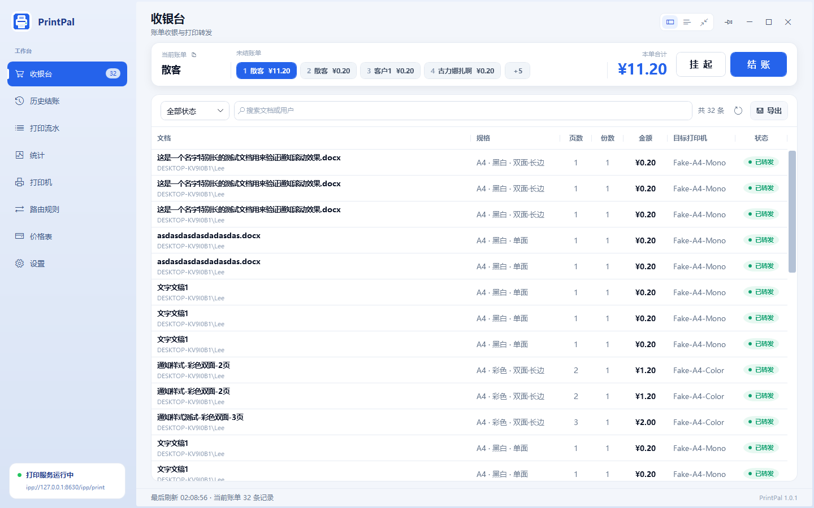

- 顶部收银条：`未结账单` 标题 + 序号 chip 列表（当前账单高亮，溢出折叠「+N」）、`本单合计`、`挂起`、
  `结账`；挂起/结账为 0 单时禁用。
- 切换账单：点未结账单列表里的其他账单即切换（旧账单自动挂起、列表位置不变），点当前账单无动作；
  点「+N」弹出全部账单浮层（序号 / 名称 / 挂起时间 / 金额右对齐），整行点击切换；
  当前空账单在切换时自动删除，空账单不会堆积。
- 筛选：状态、文档/用户搜索；右侧显示筛选结果数、刷新、导出 CSV（标题栏不再重复放刷新按钮）。
- 列：文档（含用户）、规格（纸张/颜色/单双面）、页数、份数、金额、目标打印机、状态；金额列与表头右对齐。
- 状态胶囊：
  - 绿色：已转发、在线、启用；
  - 蓝色：转发中；
  - 橙色：待转发、待确认、未路由、未知、未测试；
  - 红色：失败、连接失败。
- 右侧详情（2026-11-02 重构为分组布局，见下图）：单击任务后显示（纯信息展示，不含操作按钮）；
  - 顶部：文档名 + `用户 · 时间`；**文件流水号**（等宽字体，右侧「复制」小图标一键复制）；
  - 状态胶囊与「本任务金额」并排突出显示；
  - `状态说明`：仅在失败/未知等有原因时出现，按状态着色（失败红、未知橙）；
  - `计价`：单面价 / 双面价（金额核对用；不再展示完整计价公式文本）；
  - `规格`：纸张、颜色、单双面、页数（页/份 = 面）、张数（双面 + 单面）；
  - `转发`：目标打印机、转发时间（含年月日）；
  - `文档`：格式、大小、文件名、目录、SHA-256；文件名与 SHA-256 超长时省略号显示，悬停看完整值；
    `目录` 允许换行完整显示，右侧「复制」小图标一键复制完整路径；
  - 标题栏「复制详情」把整段纯文本复制到剪贴板（排障贴日志用）。
  - **宽度可拖拽**：列表与详情之间可拖拽调整详情宽度（默认 360，范围 260–760），
    保存到数据库 `Settings.detailsWidth`；切换任务、自动刷新、重启都不改变宽度。
- 收银条「当前账单」小字右侧有「复制账单流水号」小图标（不占额外空间），复制当前账单的 17 位流水号。
- 关闭详情：点列表空白处自动关闭，或标题栏右上角 `关闭打印详情` 按钮把整个详情卡片关掉，列表占满整行，不保留窄条；
  关闭后单击任意任务行即重新打开并显示该任务的详情（关闭状态不受 1 秒自动刷新影响，重启后恢复默认显示）。

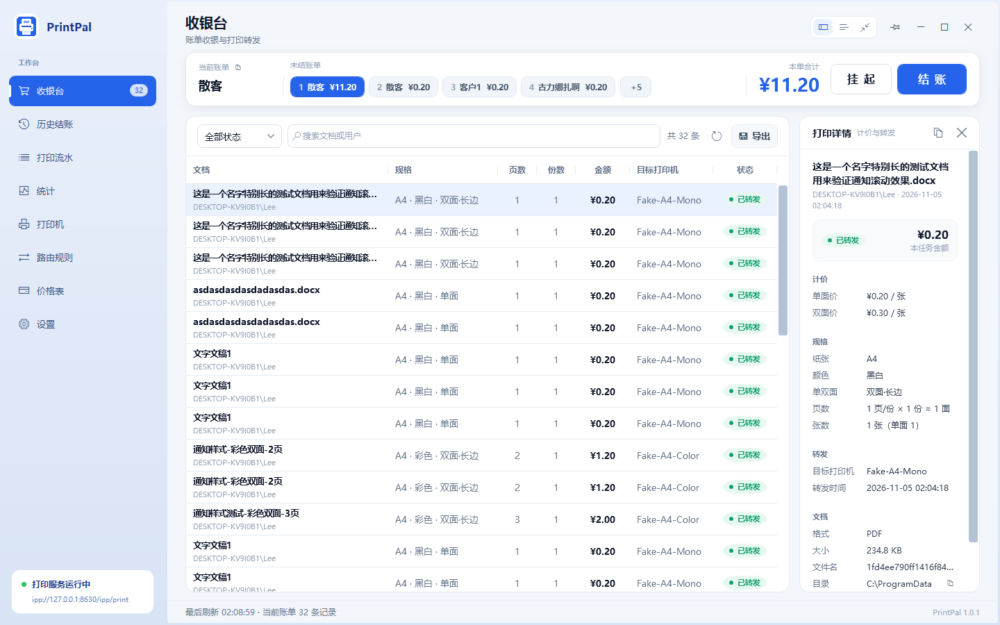
- 操作（右键菜单，完整/紧凑模式任务列表可用；右键任务行会先选中该行）：`转发 / 重试`、`选择目标`、
  `打开文档`（系统默认程序直接打开）、`打开所在目录`（资源管理器定位该文件）、`移到其他账单`、`删除记录`。
- 移到其他账单：把记错账单的任务改到另一张未结账账单，或「新建账单（并切换为当前）」；
  两边金额/单数立即更新；正在转发的任务与已结账账单会被拒绝。
- 空状态：没有任务时显示打印引导，不再是一块空白表格。
- 金额核对：5 页 × 2 份、A4 彩色双面 = `(2×1.20 + 1×0.80) × 2 = ¥6.40`。

---

## 3. 历史结账

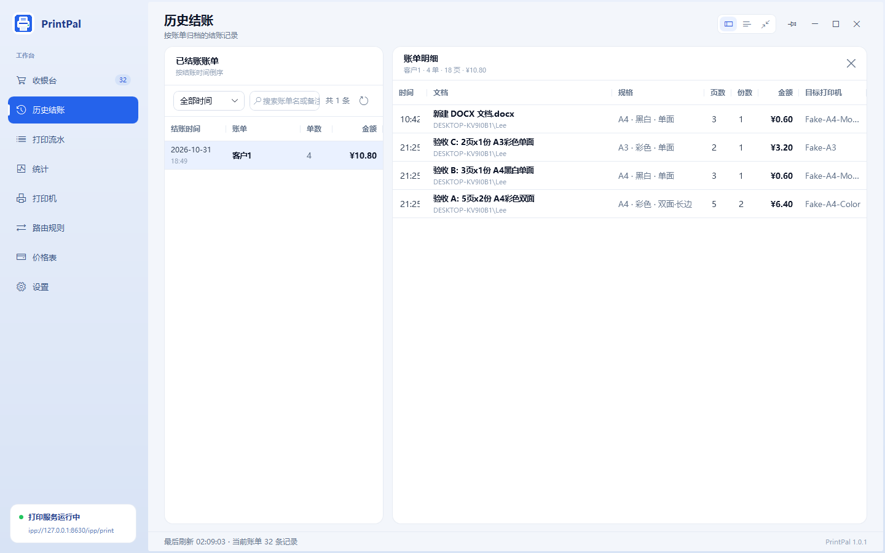

- 页面没有收银条：只有页面标题、`已结账账单` 列表（结账时间 / 账单 / 单数 / 金额，按结账时间倒序）。
- 筛选：`全部时间 / 今天 / 近 7 天 / 近 30 天` + 关键字（账单名 / 备注）；右侧显示 `共 N 条`、刷新。
- 默认不展示明细：点某一行才打开右侧「账单明细」（账单名 · 单数 · 页数 · 金额 + 其中的任务列表）；
  标题栏右上角 `关闭账单明细` 收起，再点任意账单行重新打开；1 秒自动刷新不会自动打开明细。
- **明细宽度可拖拽**：列表与明细之间可拖拽调整宽度（默认 460，范围 320–900），
  保存到数据库 `Settings.historyDetailsWidth`；切换账单、自动刷新、重启都不改变宽度。
- 已结账账单只读：不能转发、删除或移动其中的任务。

---

## 4. 打印流水

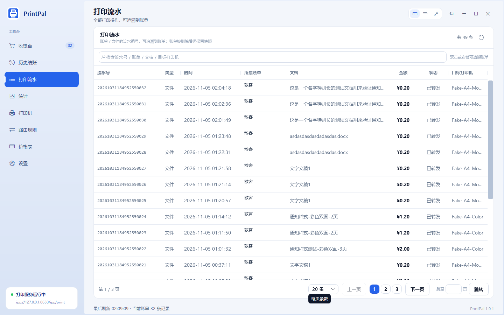

- 编号规则：账单 = 本地时间 `yyyyMMddHHmmss` + 3 位毫秒（17 位，如 `20261102223812001`）；
  文件 = 账单号 + 3 位序号（20 位，如 `20261102223812001001`），同一账单内递增。
- 页面**只展示文件（打印任务）流水**；账单流水仍保留在库里用于追溯与统计，不在此列表出现。
- 每张账单、每条打印任务各一条流水；任务状态/金额/目标变化会刷新快照；任务换账单后按新账单重新编号。
- 追溯：双击行或右键「追溯账单」——账单未结账 → 切到收银台并选中该任务/账单；
  已结账 → 跳到历史结账，**自动打开该账单明细并选中对应打印任务**（高亮 + 滚动到可见）；
  账单已删除 → 弹窗展示快照（流水号 / 账单名 / 金额 / 状态）。
- 删除：右键「删除流水」二次确认；只删流水，账单与任务不受影响（软删除，编号不复用）。
- 筛选：关键字（流水号 / 账单 / 文档 / 目标打印机）；列表按时间倒序。
- **分页**：底部工具栏显示「第 x / y 页」、页码按钮（1、2、3…，页数多时用「…」省略）、
  每页 20 / 50 / 100 条（默认 50）、上一页 / 下一页（边界自动禁用），以及「跳至 [ ] 页」输入框
  （回车或点「跳转」直达）；搜索时自动回到第 1 页，追溯时自动跳到目标所在页。
- 兼容：旧版服务/安装包写入的账单与任务，在打开流水页时会自动补流水。

---

## 5. 统计

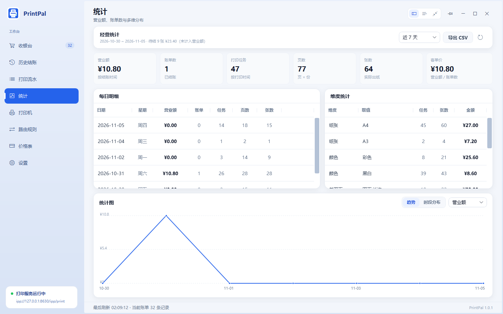

- 范围：今天 / 近 7 天 / 近 30 天 / 全部时间 / **自定义**。
  - 自定义：两个日期选择器（开始 / 结束），日历可切换月/年视图；**选完开始日期会自动弹出结束日期选择**，
    减少一次点击；区间最长一年（366 天），超出自动截断并提示。
  - **刷新时机**：只改开始日期时先不刷新（提示「已选择开始日期，请选择结束日期后更新统计」），
    选完结束日期才更新；直接改结束日期则立即更新。
- KPI：营业额（按结账时间，仅已结账账单）、账单数、打印任务、页数（页 × 份）、张数（实际出纸）、
  客单价（营业额 / 账单数）；顶部提示待结账单张数与金额（不计入营业额）。
- **页面顺序**：标题 → KPI → 每日明细 / 维度统计（中间，自适应高度）→ 统计图（最下方，固定高度）。
- **统计图（趋势 / 时段分布 二选一，同一块位置切换）**：
  - 趋势：按天折线，指标可切换（营业额 / 账单数 / 任务数 / 页数 / 张数）；中间没有数据的天按 0 补齐；
    鼠标悬停显示竖向参考线与「日期 · 数值」气泡；
  - 时段分布：本地时间 0–23 点任务数柱状图（悬停看金额）。
- 每日明细：日期 / 星期 / 营业额 / 账单 / 任务 / 页数 / 张数。
- 维度统计：纸张、颜色、单双面、目标打印机（任务 / 张数 / 金额）。
- 对齐：日期、维度、取值左对齐，其余数值列与表头居中。
- 空数据：卡片保持原有高度，显示「当前范围内没有数据」，不会塌缩。
- 加载过渡：统计耗时超过 200ms 时显示「正在统计…」遮罩（本地 SQLite 通常很快，避免闪烁）。
- 导出 CSV：每日、维度、时段三段，UTF-8 BOM，Excel 直接打开不乱码。

---

## 6. 打印机

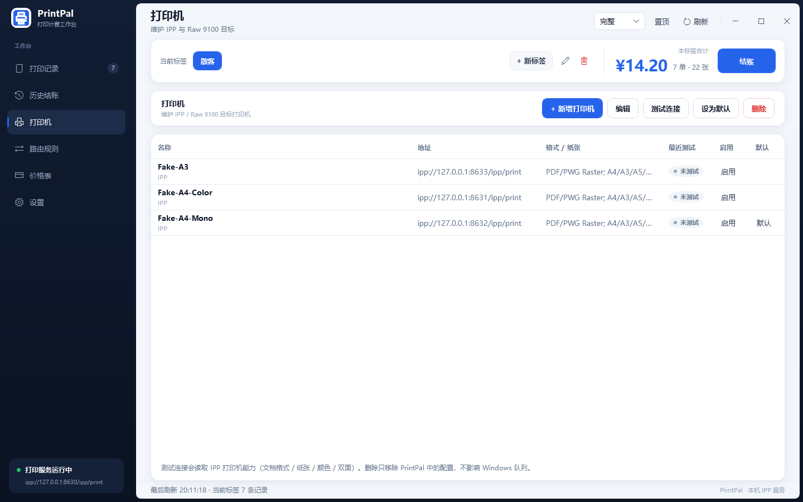

- 工具栏：新增、编辑、测试连接、设为默认、删除；双击行直接进入编辑。
- 列：名称（含协议）、地址、格式/纸张能力、最近测试、启用、默认。
- 测试连接：IPP 读取 `Get-Printer-Attributes`（格式/纸张/颜色/双面）；Raw 测试 TCP 9100。
- 删除只移除 PrintPal 中的配置，不影响 Windows 队列。

---

## 7. 路由规则

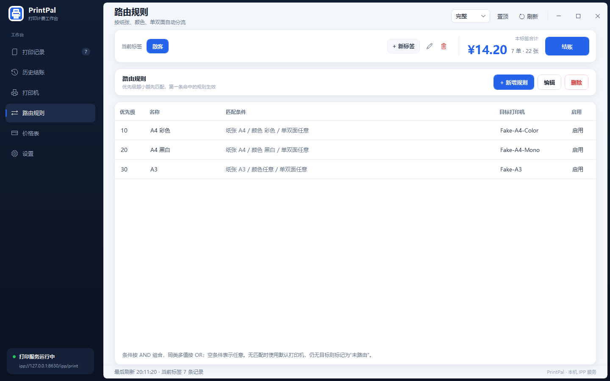

- 工具栏：新增、编辑、删除；双击行直接进入编辑。
- 列：优先级、名称、匹配条件、目标打印机、启用。
- 条件：纸张、颜色、单双面、每份页数范围、来源应用正则、文档名正则。
- 同类多值 OR；不同类 AND；空条件 = 任意；优先级越小越先匹配。
- 无匹配 → 默认打印机；仍无 → `Unrouted`，不会自动转发。

---

## 8. 价格表

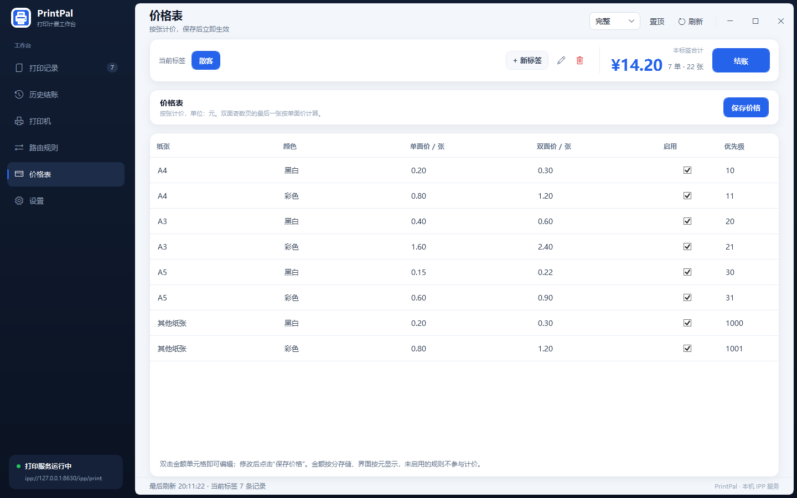

- 按“张”配置单面价/双面价，单位：元；保存为分。
- 双面奇数页最后一张按单面价；按“每份”计算再乘份数。
- 双击金额单元格编辑，修改后点“保存价格”；双击其他列打开「价格编辑」窗口
  （纸张/颜色只读展示，可改单双面价、优先级与启用）；后台刷新不会覆盖正在编辑的单元格。
- 默认 8 条（A4/A3/A5 × 黑白/彩色）+ “其他纸张”兜底。

---

## 9. 设置

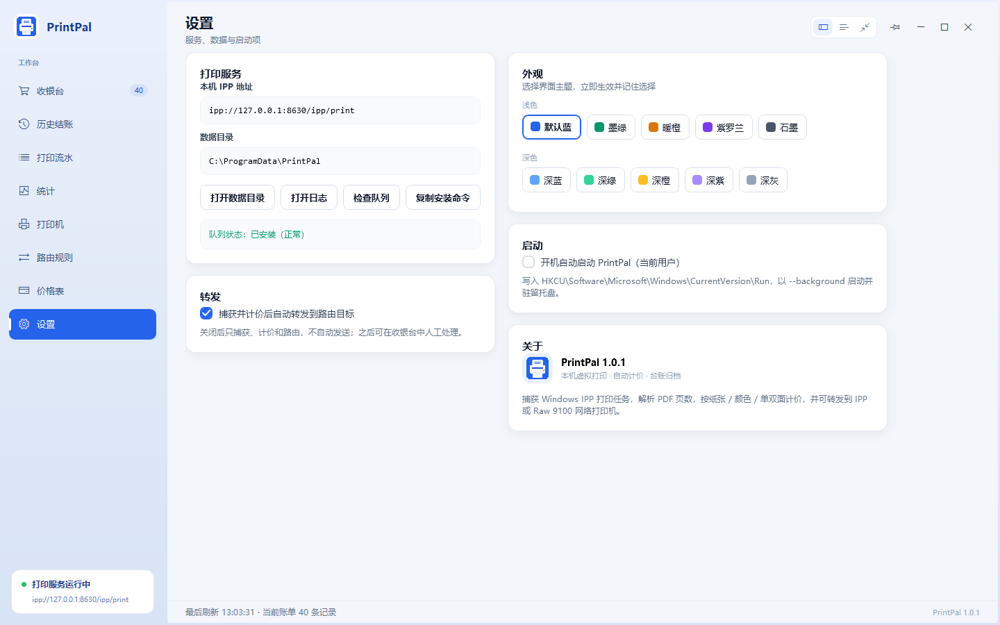

- **打印服务**：IPP 地址、数据目录、打开数据/日志、检查队列、复制安装命令、队列状态；
  点击「检查队列」先显示「检查中 ...」过渡状态，后台查询后回填结果（检查期间按钮禁用）。
- **外观**：**10 套主题**（浅色 5 套：默认蓝 / 墨绿 / 暖橙 / 紫罗兰 / 石墨；深色 5 套：深蓝 / 深绿 / 深橙 / 深紫 / 深灰），
  点击立即生效并写入 `Settings.uiTheme`，重启后保留；主题会同时刷新品牌色、背景、卡片、线条、文字、
  **滚动条（每套主题各自的色调，浅色主题之间也会变化）、输入框、提示气泡、浅色/深色侧边栏、导航选中态、
  工作台标签、底部状态卡、右上角模式切换按钮、极简模式卡片与模式选择器**，成功/警告/危险等语义色保持固定。
- **转发**：关闭自动转发后，新任务保持 `Held（待确认）`，可在打印详情中人工转发。
- **启动**：开机自启（HKCU Run，`--background`）。
- **关于**：版本与技术栈。

---

## 10. 紧凑模式

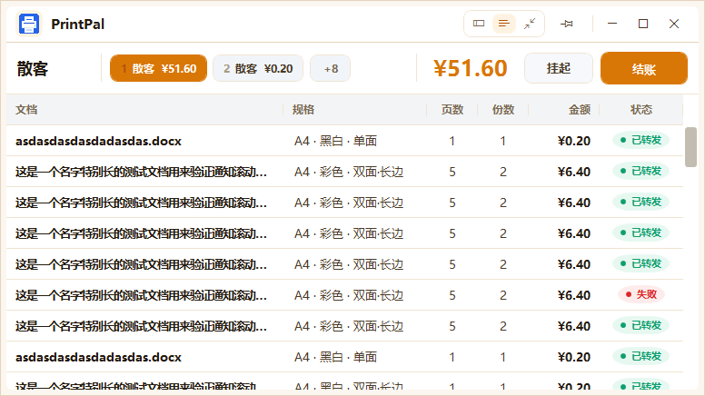

- 顶部：品牌 + 完整/紧凑/极简图标按钮组、置顶、窗口按钮；标题栏空白处可拖动窗口（高 44）。
- 贴边紧凑布局：账单条（`当前账单`、`未结账单` 切换条、`本单合计` 金额、`挂起`、`结账` 单行展示，
  无小字标题）与任务表直接贴边，用发丝线分隔；无未结账单时列表隐藏。
- 列表：文档（不显示主机名、行高 30）、规格、页数、份数、金额、状态；默认窗口 776×436。
- 适合前台快速查看；不显示配置页和打印详情面板。

---

## 11. 极简模式

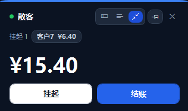

- 316×186 深色悬浮卡，默认右下角、默认置顶。
- 顶部不显示品牌：左侧是当前账单名（双击改名），右侧是模式切换、置顶和隐藏到托盘。
- 第二行是未结账单 chip 条（无未结账单时整行隐藏）；下面是金额，以及等宽的「挂起 / 结账」两个按钮。
- chip 超出宽度时折叠进小号深色「+N」（点击弹出全部账单浮层），窗口尺寸不随账单数量变化；
  当前账单 chip 高亮，列表右侧不画分割线。
- **打印通知**：极简模式下有新文件打印时，窗口下方出现醒目的琥珀色滚动通知条，
  左侧固定一个喇叭图标，内容为「文档名 → 目标打印机 · 金额 · 状态」；
  文本超长时**来回反复滚动**（0 → 末尾 → 0 循环，两端有缓动），滚动到最后一个字刚好贴住右边缘，
  不会滚过头留空白；右侧留 10px 边距避免被圆角裁掉最后一个字；
  窗口临时加高 42px，约 12 秒后自动收起并恢复高度；
  多条新任务用 `｜` 分隔（最多显示 3 条，超出显示「等 N 个文件」）。
- **主题**：极简卡片、顶部色条、金额/账单名文字、未结账单 chip、挂起/结账按钮、模式选择器都跟随主题；
  模式选择器与完整/紧凑模式同一套思路（激活项用主题强调色 + 白色图标，非激活项透明），
  浅色主题下是浅色卡片 + 深色文字，深色主题下是深色卡片 + 浅色文字。


---

## 12. 托盘 / 单实例 / 后台

- 关闭窗口 → 隐藏到托盘，Agent 继续接收任务；托盘双击/“打开 PrintPal”恢复。
- 托盘菜单可直接切换完整/紧凑/极简模式。
- 托盘“退出” → 停止 Agent、释放单实例互斥体、退出。
- 单实例：`Local\PrintPal.App.SingleInstance`；第二次启动提示“已在运行”。
- `--background`：启动后不显示主窗口，只留托盘（用于开机自启）。
- 日志：`<数据目录>\logs\app.log`。

---

## 13. 交互与布局细节

- **窗口**：无边框标题栏；标题区域可拖动；双击标题区域最大化/还原；最大化使用显示器工作区，
  不遮挡任务栏；Windows 11 自动应用圆角。
- **表格**：统一行高 46、表头 40、无竖向网格线；行悬浮/选中为浅色；金额列右对齐加粗；
  窄窗口下列保持最小宽度并出现横向滚动条，不会把文字挤到不可读。
- **空状态**：任务列表为空时显示图标 + 引导文案，表头仍然可见。
- **自动刷新**：1 秒轮询；保存选中任务/打印机/路由/历史账单，并恢复表格滚动位置，避免列表跳动。
- **对话框**：打印机、路由、账单改名、移到其他账单、选择目标均为统一卡片式布局；小屏幕下自动限制最大高度并滚动。
- **模式记忆**：完整/紧凑记忆尺寸、位置在每次切换时居中；极简记忆位置；置顶按模式记忆；
  窗口状态（最大化）使用还原尺寸保存。

---

## 14. 已知限制

- UI 为代码后置，未引入 MVVM；复杂化时再重构。
- 队列状态需点“检查队列”或重启应用刷新；未做实时监听。
- CSV 导出当前筛选结果，不包含计价明细列。
- 自启由安装器写入 HKCU，指向安装目录；开发版仍指向当前 exe。
- 重试次数/间隔暂未暴露到 UI 设置。
- 超时 `Unknown` 需要用户判断是否重打；Raw 9100 无幂等元数据。
- 极简模式隐藏到托盘后只能通过托盘恢复；不提供任务栏按钮。
