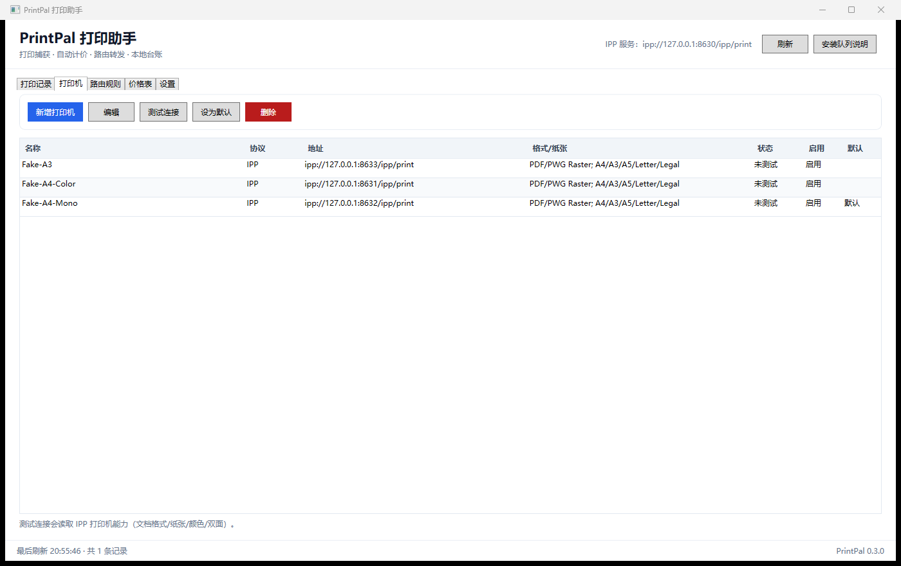
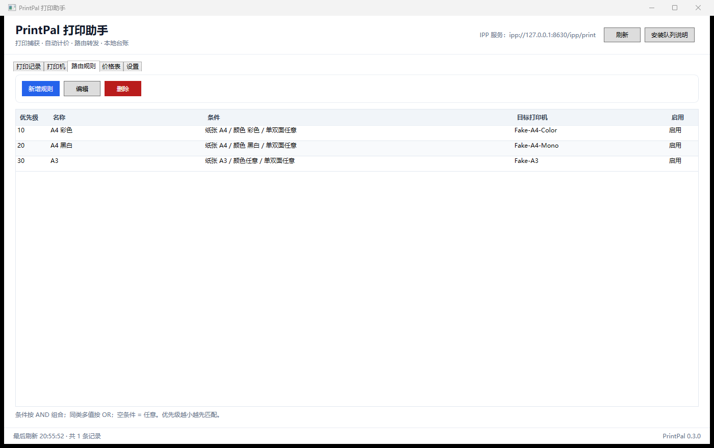
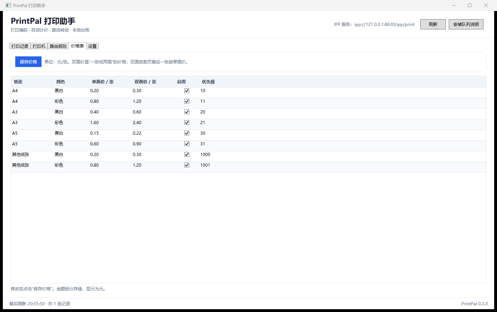
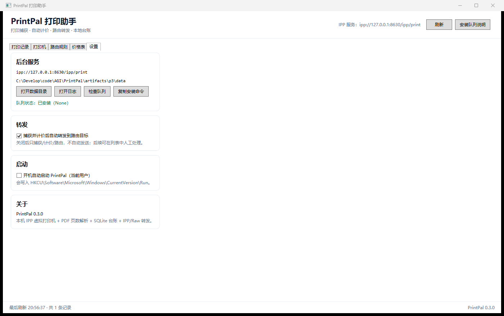

# PrintPal UI 说明

> 截图来自 P3/P4（App 0.3/0.4）；P5 安装版为 0.5.0，页面与交互一致。
> 2026-10-29 更新：新增标签计费 + 完整/简洁/极简三模式；旧截图中的“今日/本周/本月”汇总已移除。

> 更新：2026-10-29
> 入口：`src/PrintPal.App`（WPF）

---

## 0. 2026-10-29 标签 / 三模式

- 标签栏：`标签1`、`标签2`……，可改名；
- 每个标签一个未结账会话；结账后自动归档并切下一个/新建；
- 完整模式：配置 + 文件列表 + 历史；
- 简洁模式：标签 + 金额 + 文件列表 + 新建/结账；
- 极简模式：金额 + 当前标签 + 结账，无文件列表，默认右下角；
- 每个模式独立保存置顶开关/位置；
- 主界面不显示全店今日/本周/本月统计。

下面的 P3–P5 截图仅保留作历史参考。

---

## 1. 启动

```powershell
# 开发演示：独立数据目录 + 3 台 FakePrinter 路由
.\scripts\Start-PrintPalApp.ps1 -SeedDemo

# 生产默认数据目录：%LOCALAPPDATA%\PrintPal
.\scripts\Start-PrintPalApp.ps1
```

安装队列（管理员）：

```powershell
powershell.exe -NoProfile -ExecutionPolicy Bypass -File .\scripts\Install-PrintPalQueue.ps1
```

打印后，WPF 每 2 秒刷新一次列表；新任务会出现在“打印记录”，并自动选中首行显示详情。

---

## 2. 打印记录


- 当前标签：金额 / 单数；已移除全店当日/本周/本月汇总卡片。
- 筛选：本标签、状态、文档搜索。
- 列：时间、文档、纸张、颜色、单双面、页数、份数、单价、金额、目标打印机、状态。
- 详情：文档、用户、时间、纸张/颜色/单双面、页数×份数、总张数（双面+单面）、金额、
  目标、状态/原因、格式、路径、SHA-256、计价明细。
- 操作：打开文档（资源管理器定位）、删除记录（软删除）、导出 CSV（当前筛选结果）。
- 金额核对：5 页 × 2 份、A4 彩色双面 = `(2×1.20 + 1×0.80) × 2 = ¥6.40`。

> “单价”列显示主单价（双面任务显示双面价/张）；奇数页最后一张的单面价在详情“计价明细”中。

---

## 3. 打印机



- 列表：名称、协议（IPP/Raw 9100）、地址、格式/纸张、最近测试状态、启用、默认。
- 新增/编辑：名称、协议、主机、端口、IPP 路径、文档格式（Auto/PDF/PWG/PS）、启用、默认、备注。
- 测试连接：
  - IPP：`Get-Printer-Attributes`，回填格式/纸张/颜色/双面能力；
  - Raw：TCP 连接 9100。
- 设为默认：路由无匹配时使用默认打印机。
- 删除：仅从 PrintPal 配置删除，不影响 Windows 队列。

---

## 4. 路由规则



- 条件：纸张、颜色、单双面、每份页数范围、来源应用正则（IPP 路径暂为空）、文档名正则。
- 同类多值 OR；不同类 AND；空条件 = 任意。
- 优先级越小越先匹配；第一条匹配且目标格式兼容的规则生效。
- 无匹配 → 默认打印机；仍无 → `Unrouted`，不会自动转发。

---

## 5. 价格表



- 按“张”配置单面价/双面价；单位元，保存为分。
- 双面奇数页最后一张按单面价；按“每份”计算再乘份数。
- 默认 8 条（A4/A3/A5 × 黑白/彩色），另有“其他纸张”的 A4 兜底价。
- 修改后点“保存价格”；后台刷新不会覆盖正在编辑的单元格（`_pricesDirty`）。

---

## 6. 设置



- 后台服务：IPP URI、数据目录、打开数据/日志、检查队列、复制安装命令。
- 转发：自动转发开关（持久化到 `Settings.autoForward`）。
- 启动：开机自启（HKCU Run，`"PrintPal.App.exe" --background`）。
- 关于：版本、技术栈。

“检查队列”使用 `System.Printing.LocalPrintServer`；未安装/离线会给出提示。

---

## 7. 托盘 / 单实例 / 后台

- 关闭窗口 → 隐藏到托盘，Agent 继续接收任务；托盘双击/“打开 PrintPal”恢复。
- 托盘“退出” → 停止 Agent、释放单实例互斥体、退出。
- 单实例：`Local\PrintPal.App.SingleInstance`；第二次启动提示“已在运行”。
- `--background`：启动后不显示主窗口，只留托盘（用于开机自启）。
- 日志：`<数据目录>\logs\app.log`（Agent/流水线输出重定向）。

---

## 8. P4 人工确认 / 重试 / 目标覆盖


- 关闭“自动转发”（设置页）或启动时 `--no-auto-forward`：捕获/计价/路由后状态为 **Held（待确认）**，
  不自动发送。
- 详情面板按钮：
  - **转发/重试**：按当前目标入队；适用于 Held/Failed/Unknown/待转发；
  - **选择目标转发**：选择任意启用打印机并覆盖目标后入队；
  - 已成功任务不可重试；待确认（无有效计价）任务不可转发。
- 转发在后台 `ForwardingWorker` 执行，UI 通过 2 秒轮询看到：
  `待确认 → 转发中 → 已转发/失败/未知`。
- 重试默认最多 4 次，间隔 2s/10s/30s；明确失败自动重试，超时置 **Unknown** 不自动重试。
- IPP 转发的 job-name 追加 `[PrintPal:<JobId>]`，FakePrinter 日志可见。

P4 实测：`--no-auto-forward` 下 5 页×2 份 A4 彩色双面 → Held，FakePrinter 未收到；
UI 点击“转发/重试”后第 1 次成功，FakePrinter 收到 PDF（5 页，534,128 B）。

## 9. P3 冒烟结果

| 项 | 结果 |
|---|---|
| 应用启动 + Agent 8630 | ✅ |
| 队列安装 + 5 页×2 份彩色双面 | ✅ ¥6.40 |
| Fake-A4-Color 收到 PDF | ✅ 5 页，535,559 B |
| 列表/汇总/详情 | ✅ |
| 打印机/路由/价格/设置页 | ✅ |
| 托盘/关闭隐藏 | 代码实现，手工冒烟 |
| 单实例/自启 | 代码实现，待 P6 自动化 |

---

## 10. 已知限制

- UI 使用代码后置，未引入 MVVM；页面复杂化时再重构。
- 队列状态需点“检查队列”或重启应用刷新；未做实时监听。
- CSV 导出当前筛选结果，不包含计价明细列。
- 自启由 P5 安装器写入 HKCU，指向安装目录；开发版仍指向当前 exe。
- P3/P4 没有 UI 自动化测试；P6 补。
- P4 转发 worker 串行；重试延迟期间后续任务会等待。
- 重试次数/间隔暂未暴露到 UI 设置。
- 超时 Unknown 需要用户判断是否重打；Raw 9100 无幂等元数据。
