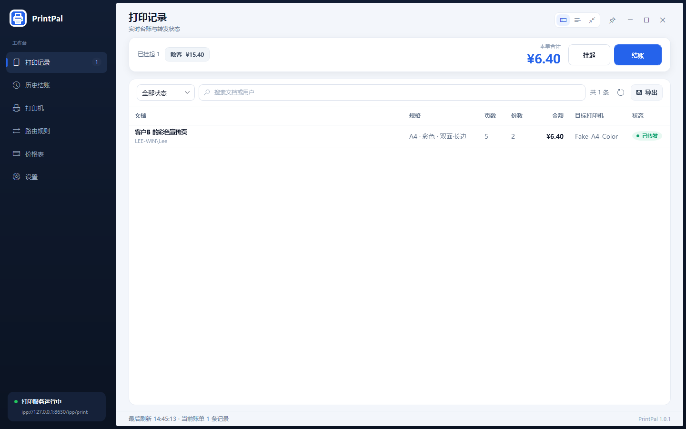
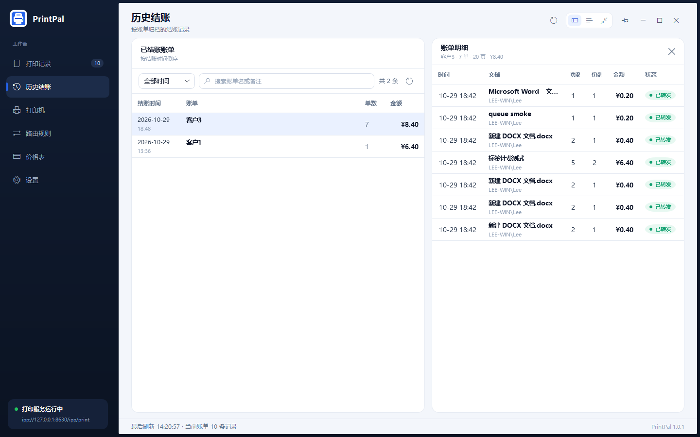
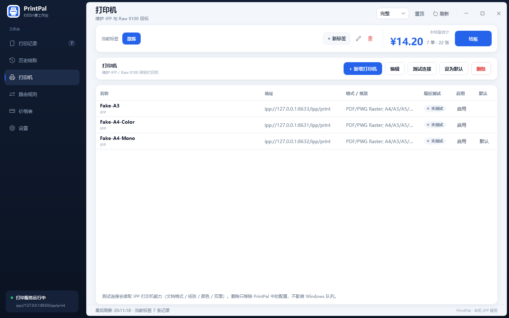
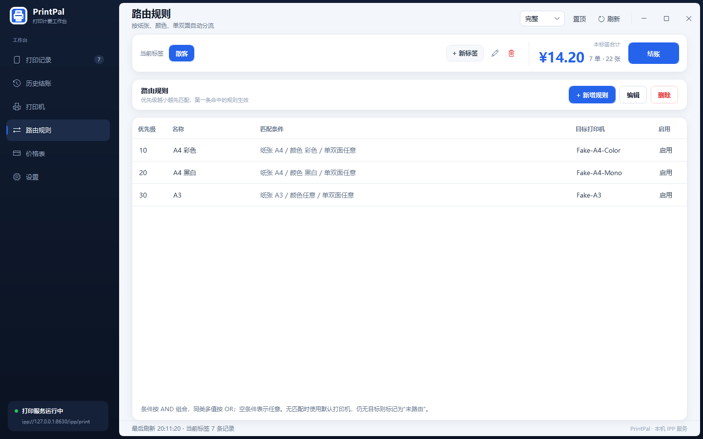
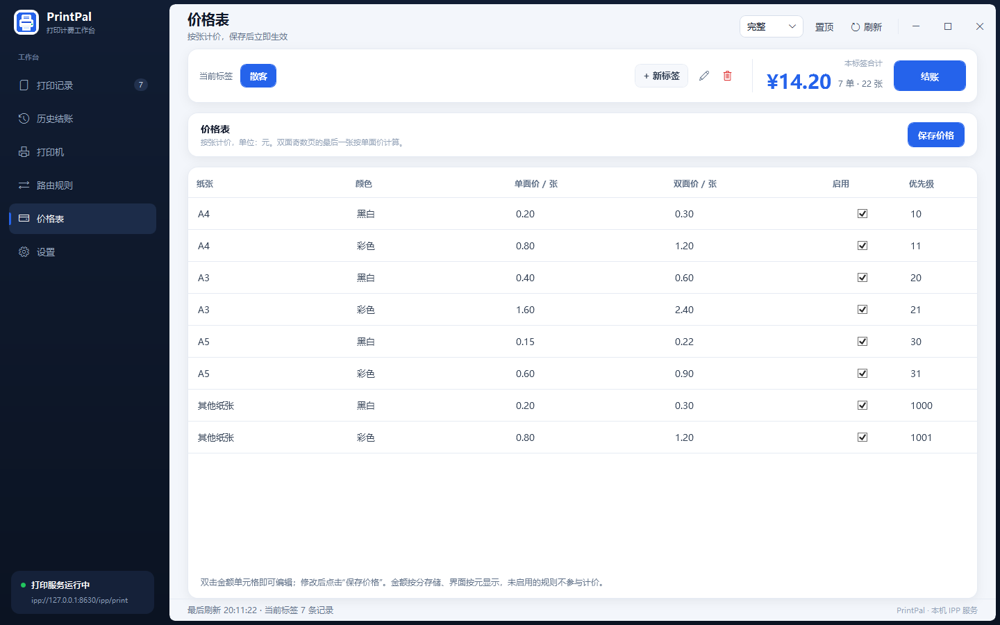
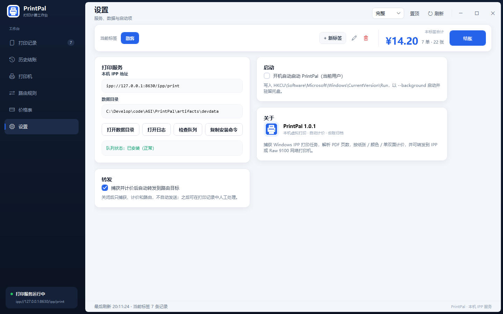
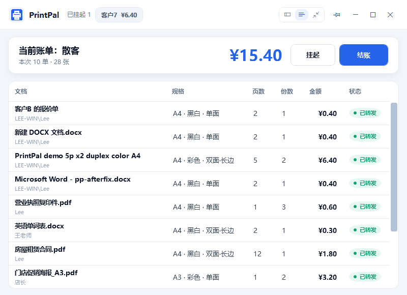

# PrintPal UI 说明

> 2026-10-31 未结账单切换器：当前账单入列表高亮、点击切换且顺序不变、溢出折叠「+N」（三模式统一）；
> 新账单默认名「散客」；简洁模式改三列平行布局并补「本单合计」；极简去滚动条。
> 2026-10-30 账单与挂起：标签改为账单，新增挂起/取回、任务改挂账单、历史筛选与明细开关。
> 2026-10-29 界面重构：左侧导航、浮动标签/金额条、右侧任务详情、统一主题与无边框窗口。
> 入口：`src/PrintPal.App`（WPF，net10.0-windows）。
> 本文截图使用开发演示数据（3 台 FakePrinter + 演示任务）。

---

## 0. 设计概览

- **应用框架**：深色外壳 + 浮起的浅色圆角主面板。左侧导航栏上下延伸到窗口边缘，主面板四周
  内缩 6 px、四角 2 px 圆角（外层 Windows 11 圆角 8 px − 内缩 6 px 的同心圆角，深色边框四边等宽），
  由深色外壳包裹；顶部保留页面标题、
  模式切换（完整/简洁/极简图标按钮组）、置顶（图钉图标，置顶后变为已固定样式）、刷新（图标）和窗口按钮。
- **收银条**：只在「打印记录」页显示当前账单、未结账单切换条（当前账单高亮、溢出折叠「+N」）、
  本单合计与「挂起 / 结账」；历史、打印机、路由、价格、设置页不再显示这一条。
- **账单与挂起**：每张账单 = 一个客户的一次消费，全局恰好一张「当前账单」。客户插队时点「挂起」，
  当前账单转入挂起区（任务和金额原地保留），系统自动开一张新账单；
  在未结账单列表里点其他账单即切换（当前账单高亮，顺序不变）。
- **打印记录**：左侧筛选 + 任务列表；任务详情与转发操作在单击任务后显示在右侧，未选中时不占空间；
  详情右上角的关闭按钮可把整块面板关掉，单击任意任务行会重新打开。
- **历史结账**：账单列表默认占满整行，点某一行才打开右侧「账单明细」，可关闭；带时间范围与关键字筛选。
- **统一组件**：按钮、输入框、下拉框、复选框、表格、状态胶囊、滚动条、对话框均使用同一套主题
  （`Themes/Theme.xaml`）。
- **窗口**：无边框 + 自定义标题栏，支持拖动、双击最大化、贴边缩放和 Windows 11 圆角；
  最大化严格贴合工作区、不覆盖任务栏；主面板内容按 8 px 圆角几何裁剪，按钮悬浮背景不会溢出圆角。
- **三种模式**：完整、简洁、极简共用同一套视觉和数据；各模式独立保存尺寸和置顶状态；
  切换到完整/简洁时窗口自动居中，极简记忆位置（默认右下角）。

---

## 1. 启动

```powershell
# 开发演示：独立数据目录 + 3 台 FakePrinter 路由
.\scripts\Start-PrintPalApp.ps1 -SeedDemo

# 生产默认数据目录：%LOCALAPPDATA%\PrintPal
.\scripts\Start-PrintPalApp.ps1
```

安装队列（管理员）：

```powershell
powershell.exe -NoProfile -ExecutionPolicy Bypass -File .\scripts\Install-PrintPalQueue.ps1
```

打印后 WPF 每 2 秒刷新一次；有选中任务时保持选中，滚动位置也会保留。

---

## 2. 打印记录



- 顶部收银条：`未结账单` 标题 + 序号 chip 列表（当前账单高亮，溢出折叠「+N」）、`本单合计`、`挂起`、
  `结账`；挂起/结账为 0 单时禁用。
- 切换账单：点未结账单列表里的其他账单即切换（旧账单自动挂起、列表位置不变），点当前账单无动作；
  点「+N」弹出全部账单浮层（序号 / 名称 / 挂起时间 / 金额右对齐），整行点击切换；
  当前空账单在切换时自动删除，空账单不会堆积。
- 筛选：状态、文档/用户搜索；右侧显示筛选结果数、刷新、导出 CSV（标题栏不再重复放刷新按钮）。
- 列：文档（含用户）、规格（纸张/颜色/单双面）、页数、份数、金额、目标打印机、状态；金额列与表头右对齐。
- 状态胶囊：
  - 绿色：已转发、在线、启用；
  - 蓝色：转发中；
  - 橙色：待转发、待确认、未路由、未知、未测试；
  - 红色：失败、连接失败。
- 右侧详情：单击任务后显示；包含文档、用户、时间（列表不显示时间，仅在详情中）、规格、张数、
  金额、目标、状态/原因、格式、路径、SHA-256、计价明细。
- 关闭详情：标题栏右上角 `关闭详情面板` 按钮把整个详情卡片关掉，列表占满整行，不保留窄条；
  关闭后单击任意任务行即重新打开并显示该任务的详情（关闭状态不受 2 秒自动刷新影响，重启后恢复默认显示）。
- 操作：`转发 / 重试`、`选择目标`、`打开文档`、`移到其他账单`、`删除记录`。
- 移到其他账单：把记错账单的任务改到另一张未结账账单，或「新建账单（并切换为当前）」；
  两边金额/单数立即更新；正在转发的任务与已结账账单会被拒绝。
- 空状态：没有任务时显示打印引导，不再是一块空白表格。
- 金额核对：5 页 × 2 份、A4 彩色双面 = `(2×1.20 + 1×0.80) × 2 = ¥6.40`。

---

## 3. 历史结账



- 页面没有收银条：只有页面标题、`已结账账单` 列表（结账时间 / 账单 / 单数 / 金额，按结账时间倒序）。
- 筛选：`全部时间 / 今天 / 近 7 天 / 近 30 天` + 关键字（账单名 / 备注）；右侧显示 `共 N 条`、刷新。
- 默认不展示明细：点某一行才打开右侧「账单明细」（账单名 · 单数 · 页数 · 金额 + 其中的任务列表）；
  标题栏右上角 `关闭账单明细` 收起，再点任意账单行重新打开；2 秒自动刷新不会自动打开明细。
- 已结账账单只读：不能转发、删除或移动其中的任务。

---

## 4. 打印机



- 工具栏：新增、编辑、测试连接、设为默认、删除。
- 列：名称（含协议）、地址、格式/纸张能力、最近测试、启用、默认。
- 测试连接：IPP 读取 `Get-Printer-Attributes`（格式/纸张/颜色/双面）；Raw 测试 TCP 9100。
- 删除只移除 PrintPal 中的配置，不影响 Windows 队列。

---

## 5. 路由规则



- 列：优先级、名称、匹配条件、目标打印机、启用。
- 条件：纸张、颜色、单双面、每份页数范围、来源应用正则、文档名正则。
- 同类多值 OR；不同类 AND；空条件 = 任意；优先级越小越先匹配。
- 无匹配 → 默认打印机；仍无 → `Unrouted`，不会自动转发。

---

## 6. 价格表



- 按“张”配置单面价/双面价，单位：元；保存为分。
- 双面奇数页最后一张按单面价；按“每份”计算再乘份数。
- 双击金额单元格编辑，修改后点“保存价格”；后台刷新不会覆盖正在编辑的单元格。
- 默认 8 条（A4/A3/A5 × 黑白/彩色）+ “其他纸张”兜底。

---

## 7. 设置



- **打印服务**：IPP 地址、数据目录、打开数据/日志、检查队列、复制安装命令、队列状态。
- **转发**：关闭自动转发后，新任务保持 `Held（待确认）`，可在任务详情中人工转发。
- **启动**：开机自启（HKCU Run，`--background`）。
- **关于**：版本与技术栈。

---

## 8. 简洁模式



- 顶部：品牌 + 完整/简洁/极简图标按钮组、置顶、窗口按钮；标题栏空白处可拖动窗口。
- 账单卡与完整模式同构：`当前账单`（双击改名）、`未结账单` 切换条（当前高亮、溢出折叠「+N」）、
  `本单合计`、`挂起`、`结账` 平行展示在同一水平线上；无未结账单时列表隐藏。
- 列表：文档、规格、页数、份数、金额、状态。
- 适合前台快速查看；不显示配置页和任务详情操作。

---

## 9. 极简模式


- 316×186 深色悬浮卡，默认右下角、默认置顶。
- 顶部不显示品牌：左侧是当前账单名（双击改名），右侧是模式切换、置顶和隐藏到托盘。
- 第二行是未结账单 chip 条（无未结账单时整行隐藏）；下面是金额，以及等宽的「挂起 / 结账」两个按钮。
- chip 超出宽度时折叠进小号深色「+N」（点击弹出全部账单浮层），窗口尺寸不随账单数量变化；
  当前账单 chip 高亮，列表右侧不画分割线。

---

## 10. 托盘 / 单实例 / 后台

- 关闭窗口 → 隐藏到托盘，Agent 继续接收任务；托盘双击/“打开 PrintPal”恢复。
- 托盘菜单可直接切换完整/简洁/极简模式。
- 托盘“退出” → 停止 Agent、释放单实例互斥体、退出。
- 单实例：`Local\PrintPal.App.SingleInstance`；第二次启动提示“已在运行”。
- `--background`：启动后不显示主窗口，只留托盘（用于开机自启）。
- 日志：`<数据目录>\logs\app.log`。

---

## 11. 交互与布局细节

- **窗口**：无边框标题栏；标题区域可拖动；双击标题区域最大化/还原；最大化使用显示器工作区，
  不遮挡任务栏；Windows 11 自动应用圆角。
- **表格**：统一行高 46、表头 40、无竖向网格线；行悬浮/选中为浅色；金额列右对齐加粗；
  窄窗口下列保持最小宽度并出现横向滚动条，不会把文字挤到不可读。
- **空状态**：任务列表为空时显示图标 + 引导文案，表头仍然可见。
- **自动刷新**：2 秒轮询；保存选中任务/打印机/路由/历史账单，并恢复表格滚动位置，避免列表跳动。
- **对话框**：打印机、路由、账单改名、移到其他账单、选择目标均为统一卡片式布局；小屏幕下自动限制最大高度并滚动。
- **模式记忆**：完整/简洁记忆尺寸、位置在每次切换时居中；极简记忆位置；置顶按模式记忆；
  窗口状态（最大化）使用还原尺寸保存。

---

## 12. 已知限制

- UI 为代码后置，未引入 MVVM；复杂化时再重构。
- 队列状态需点“检查队列”或重启应用刷新；未做实时监听。
- CSV 导出当前筛选结果，不包含计价明细列。
- 自启由安装器写入 HKCU，指向安装目录；开发版仍指向当前 exe。
- 重试次数/间隔暂未暴露到 UI 设置。
- 超时 `Unknown` 需要用户判断是否重打；Raw 9100 无幂等元数据。
- 极简模式隐藏到托盘后只能通过托盘恢复；不提供任务栏按钮。
